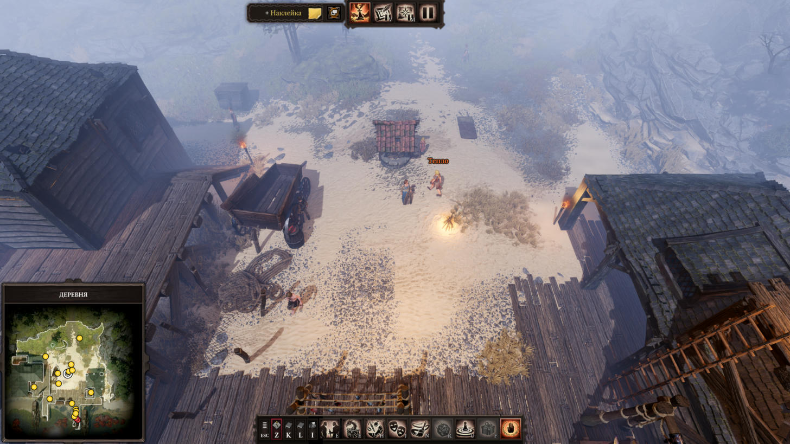
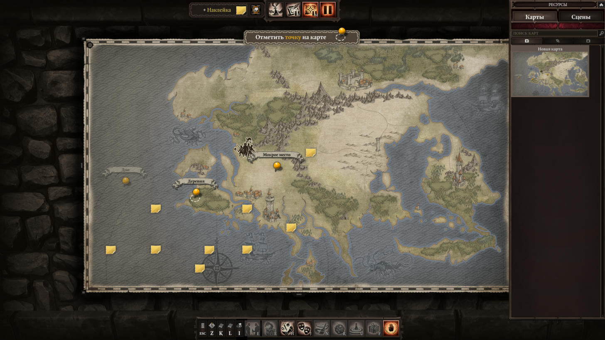
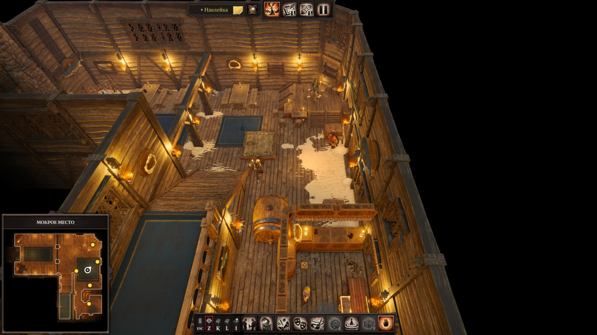

# dos2-gm-mcp

[](https://github.com/o-shabashov/dos2-gm-mcp/actions/workflows/ci.yml)

**English** · [Русский](README.ru.md)

An MCP server that lets an AI assistant prepare and run **Game Master mode campaigns in Divinity: Original Sin 2 – Definitive Edition**.

It works on two layers:

- **Campaign files.** Reads and edits a GM campaign on disk: NPC and item templates, vignettes with your own art, map stickies, the journal, scene atmosphere, add-on mods. Every write makes a backup first.
- **Live game.** Talks to the running game through a tiny bridge mod for [Norbyte's Script Extender](https://github.com/Norbyte/ositools): list who is on the level, spawn an NPC from a template, move, rename, level up, hide and show, or run any Lua on the game server.



| Overview map with GM stickies | Tavern scene with traders and stashes |
| --- | --- |
|  |  |

## What you can ask for

- "Show me what is in the campaign *My Campaign*: scenes, templates, vignettes."
- "Make an NPC template *Old Greta*, level 10, based on the witch archetype from the Larian sample campaign, with these three skills."
- "Add a vignette with this picture and three vote options."
- "Put a sticky on the overview map with the fight checklist."
- "The game is running: spawn two fire imps next to the skipper and tell me everyone's health."

The GM campaigns shipped by Larian are readable too, so they work as a library of NPC templates to copy from.

## Requirements

- Windows, Divinity: Original Sin 2 – Definitive Edition (tested on Steam build 3.6.117.3735)
- [uv](https://docs.astral.sh/uv/) and Python 3.11+
- .NET 8 runtime or newer (LSLib's `Divine.exe` needs it)
- For the live layer only: [Script Extender](https://github.com/Norbyte/ositools) v58 or newer (tested on v60)

## Install

```
git clone https://github.com/o-shabashov/dos2-gm-mcp
cd dos2-gm-mcp
uv sync
uv run dos2-gm-fetch-lslib
```

The last command downloads the official [LSLib](https://github.com/Norbyte/lslib) v1.20.4 release into `./lslib` and checks its SHA-256. LSLib is Norbyte's work under the MIT license; this repository does not redistribute it.

Connect it to Claude Code:

```
claude mcp add dos2-gm --scope user -- uv --directory C:\path\to\dos2-gm-mcp run dos2-gm-mcp
```

Or to any other MCP client:

```json
{
  "mcpServers": {
    "dos2-gm": {
      "command": "uv",
      "args": ["--directory", "C:\\path\\to\\dos2-gm-mcp", "run", "dos2-gm-mcp"]
    }
  }
}
```

For Claude Desktop there is also a one-file bundle: download `dos2-gm-mcp.mcpb` from the [latest release](https://github.com/o-shabashov/dos2-gm-mcp/releases/latest), open it, then ask the assistant to call `dos2_fetch_lslib` once. The bundle keeps LSLib and backups in `~/.dos2-gm-mcp`.

The game folder and `Documents\Larian Studios\Divinity Original Sin 2 Definitive Edition` are found automatically (Steam libraries, relocated Documents folders). Override with environment variables or a `config.json` in the project root:

| Variable | Meaning |
| --- | --- |
| `DOS2GM_CAMPAIGNS` | the `GMCampaigns` folder |
| `DOS2GM_GAME` | the game folder |
| `DOS2GM_DIVINE` | path to `Divine.exe` |
| `DOS2GM_BACKUPS` | where backups go (default `./backups`) |
| `DOS2GM_MODS`, `DOS2GM_OSIRIS_DATA` | the `Mods` and `Osiris Data` folders in the game's documents |
| `DOS2GM_HOME` | where LSLib, backups, the cache and `config.json` live (default: the project root) |

## Tools

The `campaign` argument accepts a campaign name, its folder name, its UUID, or a part of any of them.

| Read | Returns |
| --- | --- |
| `dos2_status` | paths, whether the game is running, the list of campaigns |
| `dos2_fetch_lslib` | one-time setup: downloads LSLib and checks its SHA-256 (same as `uv run dos2-gm-fetch-lslib`) |
| `dos2_campaign` | metadata and add-ons, scenes, maps with pins, vignettes, templates, stickies, journal |
| `dos2_scene` | characters in a scene (name, template, position, health, alignment, encounter), encounters, stickies |
| `dos2_templates`, `dos2_template` | NPC and item templates, or one template in full |
| `dos2_find_templates` | search templates across all campaigns by name, stats, skills, items |
| `dos2_vignettes`, `dos2_notes` | vignettes and stickies in full |
| `dos2_raw` | any campaign file as LSX, with an XPath filter |
| `dos2_backups` | backups of a campaign |

| Write | Does |
| --- | --- |
| `dos2_put_npc_template` | NPC template: copy a base from any campaign, set name, level, alignment, stat and ability changes, talents, skills, equipment |
| `dos2_put_item_template` | item template |
| `dos2_put_vignette` | vignette with your own image or a stock one, with vote answers |
| `dos2_put_note` | sticky on the overview map; edits the text of a scene sticky |
| `dos2_put_journal` | journal categories, chapters and paragraphs |
| `dos2_scene_settings` | scene atmosphere and music |
| `dos2_campaign_meta` | campaign name, description, author |
| `dos2_addon`, `dos2_mod_install` | attach a ready-made `.pak` mod to a campaign, or build a mod folder into a `.pak` and attach it |
| `dos2_delete_template`, `dos2_delete_vignette`, `dos2_delete_note` | delete |
| `dos2_backup`, `dos2_restore` | full copy of a campaign, restore from any backup |

| Live (game running) | Does |
| --- | --- |
| `dos2_live_status` | what is ready: game, Script Extender, the bridge `.pak`, attached campaigns, bridge heartbeat |
| `dos2_bridge_install`, `dos2_bridge_detach` | build the bridge into `Mods\DOS2GMBridge_….pak` and attach it to a campaign as an add-on, or detach |
| `dos2_live_characters` | who is on the level: GUID, name, template, stats, level, health, alignment, position |
| `dos2_live_spawn` | spawn a character from a root template or a GM template, at a point or next to someone |
| `dos2_live_move`, `dos2_live_set`, `dos2_live_stage` | teleport; change name, level, alignment; take off stage and bring back |
| `dos2_live_lua` | run Lua on the game server (`Ext`, `Osi`) and get the returned value |

## Safety

- Writes go to a **closed** campaign: the game is closed or sits in the main menu. While the game process is running a write needs `allow_running=true`.
- Before every write the previous files are copied to `backups\<campaign folder>\<time>-<operation>`. `dos2_restore` brings any of them back.
- Placed NPCs and encounters live in the scene cache and are read-only here; you place them in the game, or through the live layer.
- `dos2_live_lua` executes arbitrary Lua inside your game. Use it with an assistant you trust.

## Live layer setup

1. Install Script Extender: put its `DXGI.dll` next to `EoCApp.exe` in `DefEd\bin`.
2. Ask the assistant to run `dos2_bridge_install` for your campaign (the game must be closed). It builds the bridge mod and adds it to the campaign's add-ons.
3. Load the campaign in GM mode and call `dos2_live_status`.

The bridge is a server-side Lua mod (`bridge/`). On a tick it reads a command from `Osiris Data/dos2gm-mcp`, runs it and writes the answer; there are no sockets and nothing listens on the network. In multiplayer every player needs the same `.pak` and Script Extender, as with any DOS2 mod.

## What we learned about GM mode

Notes for people building their own tools; all verified in the game.

- NPC templates live in the campaign's `Eggs.lsf` as `GMExportCharacter`. The second `Attribute` node of a template holds the Game Master's changes as a delta over the base stats.
- Equipment slots: 0 helmet, 1 chest, 2 legs, 3 weapon, 4 shield, 5 and 10 rings, 6 belt, 7 boots, 8 gloves, 9 amulet, 12 horns, 15+ backpack.
- A map sticky has `Type = 2`, `UI` = map UUID, `NoteUIX/Y` in map pixels. A scene sticky has `Type = 0` and hangs on an invisible marker item in `LevelCache`.
- A mod's `meta.lsx` needs a Definitive Edition `PublishVersion` (for example `909321303`). With `1.0.0.0` the game flags the mod as made for Classic Edition and refuses it.
- "Play campaign" runs on a copy of the campaign; the prepared campaign stays untouched. Loading a GM savegame uses the mod list from the main menu, so tick your add-on mods there as well.
- Any `Osi.*` call while a campaign or level is loading crashes Script Extender natively, even though `Ext.Osiris.IsCallable()` already says yes. Gate on game state `Running`, `Paused` or `GameMasterPause`.
- During the Game Master pause, Osiris delays world actions (placing, teleporting) until the pause is lifted, and `SetOnStage` right after creating a character gets lost. The bridge marks such answers with `applies_on_unpause`.
- `CombatRoundStarted` and `CharacterVitalityChanged` never fire in GM mode. Count rounds by turns, poll health.
- Script Extender's console refuses commands during the Game Master pause; the file bridge keeps working.
- Items accept `CustomDisplayName`, `CustomDescription` and `CustomBookContent` at runtime and the values reach the players.

## Tests

```
uv run python tests/bridge_test.py                    # the real bridge Lua in Lua 5.3 against stubs
uv run python tests/mcp_probe.py                      # MCP handshake, tool list and one call over stdio
uv run python tests/check_mapping.py                  # scenes of all campaigns, read-only
uv run python tests/smoke_read.py "My Campaign"       # read-only
uv run python tests/write_test.py <temp folder>       # writes into copies of campaigns
```

## Credits

- [LSLib](https://github.com/Norbyte/lslib) and [Script Extender](https://github.com/Norbyte/ositools) by Norbyte make all of this possible.
- Divinity: Original Sin 2 is a game by Larian Studios. This is an unofficial fan tool, not affiliated with or endorsed by Larian Studios. Screenshots show the game's own art.

## License

[MIT](LICENSE)
