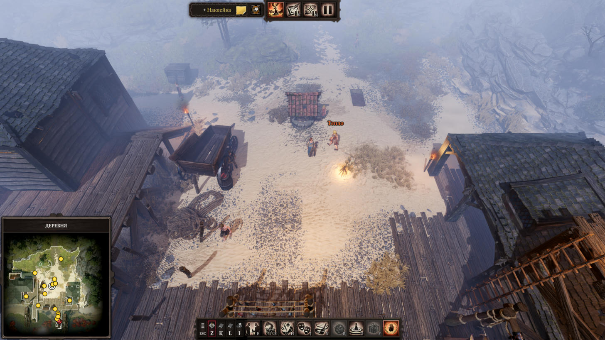

# dos2-gm-mcp

[English](README.md) · **Русский**

MCP-сервер для режима Мастера Divinity: Original Sin 2 – Definitive Edition. Через него ИИ-ассистент готовит и ведёт
кампанию на двух слоях:

- **Файлы кампании.** Читает и правит кампанию в `Документы\Larian Studios\Divinity Original Sin 2 Definitive Edition\GMCampaigns`
  через LSLib: шаблоны NPC и предметов, виньетки со своим артом, стикеры на карте, журнал, атмосферу сцен, дополнения.
  Перед каждой записью делает бэкап.
- **Живая игра.** Через маленький мод-мост для Script Extender от Norbyte: кто на уровне, поставить NPC по шаблону,
  перенести, переименовать, сменить уровень, убрать со сцены, выполнить Lua на сервере игры.



## Установка

Нужны Windows, [uv](https://docs.astral.sh/uv/), Python 3.11+, .NET 8 или новее; для живого слоя —
[Script Extender](https://github.com/Norbyte/ositools) v58+.

```
git clone https://github.com/o-shabashov/dos2-gm-mcp
cd dos2-gm-mcp
uv sync
uv run dos2-gm-fetch-lslib
```

Последняя команда скачивает официальный выпуск [LSLib](https://github.com/Norbyte/lslib) v1.20.4 в `./lslib` и сверяет
SHA-256. LSLib — работа Norbyte под лицензией MIT, в этом репозитории её копии нет.

## Подключение

```
claude mcp add dos2-gm --scope user -- uv --directory C:\path\to\dos2-gm-mcp run dos2-gm-mcp
```

Папки игры и документов находятся сами. Свои пути задаются переменными окружения `DOS2GM_CAMPAIGNS`, `DOS2GM_GAME`,
`DOS2GM_DIVINE`, `DOS2GM_BACKUPS`, `DOS2GM_MODS`, `DOS2GM_OSIRIS_DATA` или файлом `config.json` в корне проекта.
`DOS2GM_HOME` задаёт папку, где лежат LSLib, бэкапы, кэш и `config.json` (по умолчанию корень проекта).

Для Claude Desktop есть бандл одним файлом: скачайте `dos2-gm-mcp.mcpb` из [последнего выпуска](https://github.com/o-shabashov/dos2-gm-mcp/releases/latest), откройте его и попросите ассистента один раз вызвать `dos2_fetch_lslib`. Бандл держит LSLib и бэкапы в `~/.dos2-gm-mcp`.

## Инструменты

| Чтение | Что даёт |
| --- | --- |
| `dos2_status` | пути, запущена ли игра, список кампаний |
| `dos2_fetch_lslib` | разовая настройка: скачивает LSLib и сверяет SHA-256 (то же, что `uv run dos2-gm-fetch-lslib`) |
| `dos2_campaign` | метаданные и дополнения, сцены, карты с отметками, виньетки, шаблоны, стикеры, журнал |
| `dos2_scene` | персонажи сцены (имя, шаблон, позиция, здоровье, опыт, отношение, встреча), встречи, стикеры |
| `dos2_templates`, `dos2_template` | шаблоны NPC и предметов из `Eggs.lsf`, один шаблон целиком |
| `dos2_find_templates` | поиск шаблонов по всем кампаниям: имя, StatName, навыки, предметы |
| `dos2_vignettes`, `dos2_notes` | виньетки и стикеры полностью |
| `dos2_raw` | любой файл кампании как LSX, с фильтром XPath |
| `dos2_backups` | бэкапы кампании |

| Запись | Что делает |
| --- | --- |
| `dos2_put_npc_template` | шаблон NPC: копия с основы из любой кампании, имя, уровень, отношение, правки статов и умений, навыки с панелью, предметы |
| `dos2_put_vignette` | виньетка со своей картинкой или стоковой |
| `dos2_put_note` | стикер на карте «Обзор»; у стикера в сцене меняет текст |
| `dos2_delete_template`, `dos2_delete_vignette`, `dos2_delete_note` | удаление |
| `dos2_addon` | подключить к кампании готовый чужой мод из `.pak` (читает его `meta.lsx`, кладёт пак в `Mods`); `attach=false` отключает |
| `dos2_backup`, `dos2_restore` | полная копия кампании, возврат из любого бэкапа |

| Живой слой (игра запущена) | Что делает |
| --- | --- |
| `dos2_live_status` | что готово: игра, Script Extender, `.pak` моста, к каким кампаниям подключён, пульс моста |
| `dos2_bridge_install`, `dos2_bridge_detach` | собрать мост в `Mods\DOS2GMBridge_….pak`, подключить к кампании дополнением или отключить |
| `dos2_live_characters` | кто на уровне: GUID, имя, шаблон, статы, уровень, здоровье, отношение, позиция; `near` — в радиусе от персонажа |
| `dos2_live_spawn` | поставить персонажа по корневому шаблону или по шаблону Мастера, в точку или рядом с персонажем |
| `dos2_live_move`, `dos2_live_set`, `dos2_live_stage` | перенести; сменить имя, уровень, отношение; убрать со сцены и вернуть |
| `dos2_live_lua` | выполнить Lua на сервере игры (`Ext`, `Osi`), вернуть значение `return` |

Запись идёт в закрытую кампанию: игра закрыта или стоит в главном меню. Пока процесс игры запущен, запись
требует `allow_running=true`. Перед каждой записью прежние файлы ложатся в `backups\<папка кампании>\<время>-<операция>`.

## Что узнали о файлах

- Второй узел `Attribute` шаблона NPC — правки Мастера, прибавка к базовым статам (у Larian `Constitution: -6`).
- Слоты предметов: 0 шлем, 1 торс, 2 ноги, 3 оружие, 4 щит, 5 и 10 кольца, 6 пояс, 7 сапоги, 8 перчатки, 9 амулет, 12 рога, с 15 рюкзак.
- Стикер на карте: `Type = 2`, `UI` = UUID карты, `NoteUIX/Y` — пиксели карты.
- Стикер в сцене: `Type = 0`, держится за невидимый предмет-маркер `f99e4476-e744-4a68-8679-78aaa3d03f66` в `LevelCache`
  (все 638 стикеров сцен в 7 кампаниях). Новые такие стикеры ставятся в игре.
- Персонаж и его компонент боя (отношение, встреча) связаны через регион `EntityWorld`: сущность перечисляет
  handle всех своих компонентов. Порядок списков совпадает не всегда.

## Живой слой

Команды в запущенную игру: поставить NPC по шаблону, переместить, переименовать, сменить уровень, прочитать, кто
сейчас на уровне. Канал даёт Script Extender от Norbyte (github.com/Norbyte/ositools, версия v60, обновлялся в
январе 2026; режим Мастера поддерживает, `Ext.Utils.GetGameMode()` возвращает `"GameMaster"`).

Мост лежит в `bridge\Mods\DOS2GMBridge_b3c8bdc5-62be-560e-8c08-9ff16c89dac6` (`meta.lsx` по образцу
Party Size Evolved, `OsiToolsConfig.json`, `Story\RawFiles\Lua\BootstrapServer.lua` и `Bridge.lua`), клиент — в
`src\dos2gm\live.py`. `tests\bridge_test.py` гоняет настоящие Lua-файлы в Lua 5.3 (`lupa`) с заглушками `Ext`/`Osi`
против настоящего клиента: команды, ошибки, ожидание неготового Osiris, отмена по таймауту, отсутствие повтора
после перезагрузки уровня, инструменты MCP поверх моста.

1. **Script Extender.** `DXGI.dll` из `ScriptExtender-Updater-v5.zip` кладётся в `DefEd\bin` рядом с `EoCApp.exe`,
   сам экстендер докачивает загрузчик. Рядом же `OsirisExtenderSettings.json`: `{"CreateConsole": true}`.
2. **Мод-мост.** Маленький мод с `Mods/<папка>/OsiToolsConfig.json` (`FeatureFlags: ["Lua"]`, `ModTable`,
   `RequiredExtensionVersion`) и `BootstrapServer.lua`. Обработчик `Ext.Events.Tick` раз в несколько кадров читает
   `Osiris Data/mcp/in.json` (`{seq, cmd, args}`), выполняет команду из фиксированного набора и пишет
   `out.json` (`{ack_seq, result | error}`). Счётчик `seq` заменяет удаление файлов: в `Ext.IO` есть только
   `LoadFile`/`SaveFile`. Мод собирается в `.pak` через Divine и подключается к кампании дополнением —
   файловый слой допишет его в `meta.lsf` → `Dependencies`. Игрокам этот `.pak` раздаётся как любой другой мод.
3. **Команды моста** (имена API из исходников v56+): `Osi.CharacterCreateAtPosition(x, y, z, корневой шаблон, 1)`,
   `Osi.CharacterSetCustomName`, `Osi.CharacterLevelUpTo`, `Osi.TeleportToPosition`, `Osi.SetFaction`,
   `Osi.GetPosition`, `Ext.Entity.GetAllCharacterGuids()` и `Ext.Entity.GetCharacter(guid)` (`WorldPos`, `Stats`,
   `CustomDisplayName`). Ответ — JSON-строка через `Ext.Json.Stringify`.
4. **Отладчик как запасной REPL.** `"EnableLuaDebugger": true` открывает TCP 127.0.0.1:9998: длина `uint32` LE
   (считает и свои 4 байта) + protobuf `DebuggerToBackend`, `seq_no` с 1 подряд, рукопожатие
   `DbgConnectRequest{protocol_version=2}`, затем `DbgUpdateSettings{false,false}`; `DbgEvaluate` с `frame=-1`
   выполняется на следующей строке Lua, то есть через тик. Годится для разработки и потока логов: пока он подключён,
   весь Lua идёт медленнее, а клиент возможен только один.

Проверено в игре 10 ноября 2026 (Steam, 3.6.117.3735, Script Extender v60): мост грузится дополнением кампании
Мастера, тик и команды идут и на паузе Мастера; `ping` — 62 мс, Lua — 93 мс, список персонажей — 94 мс, постановка
NPC по шаблону Мастера рядом с другим персонажем — около 1 с. На паузе Мастера Osi откладывает действия с миром
(постановка на место, перенос, `CharacterSetCustomName`) до снятия паузы, поэтому мост v2 пишет имя прямо в
`CustomDisplayName` и помечает такие ответы `applies_on_unpause`.

Важно для `meta.lsx` мода: `PublishVersion` — версия редактора при публикации. С `1.0.0.0` игра пишет «Несовместимая
модификация… созданные с помощью Classic Edition» и не даёт включить мод; рабочее значение — `909321303`
(3.6.51.x, как у Party Size Evolved).

## Проверки

```
uv run python tests/smoke_read.py "Моя кампания"          # чтение, ничего не пишет
uv run python tests/check_mapping.py                       # сцены всех кампаний, ничего не пишет
uv run python tests/write_test.py <временная папка> [png]  # запись на копии кампаний
uv run python tests/bridge_test.py                         # мост в Lua 5.3 с заглушками игры
```

Пока сервер подключён к Claude Code, его `dos2-gm-mcp.exe` занят: тогда `uv run --no-sync`.

## Благодарности и лицензия

[LSLib](https://github.com/Norbyte/lslib) и [Script Extender](https://github.com/Norbyte/ositools) — работа Norbyte.
Divinity: Original Sin 2 — игра Larian Studios; это неофициальный фанатский инструмент. Лицензия проекта — [MIT](LICENSE).
